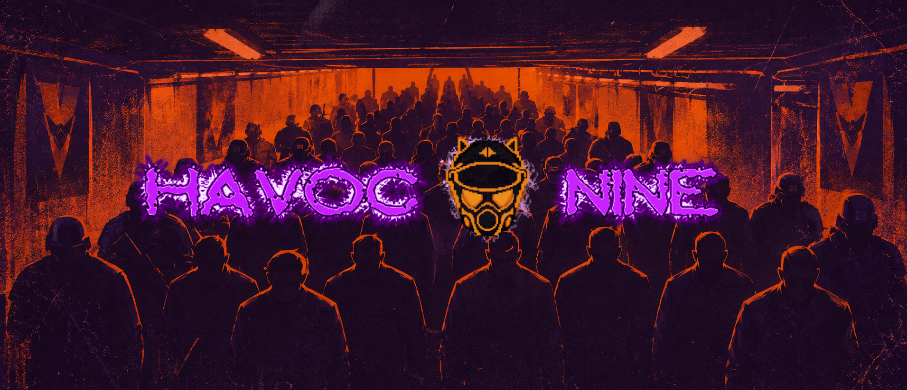
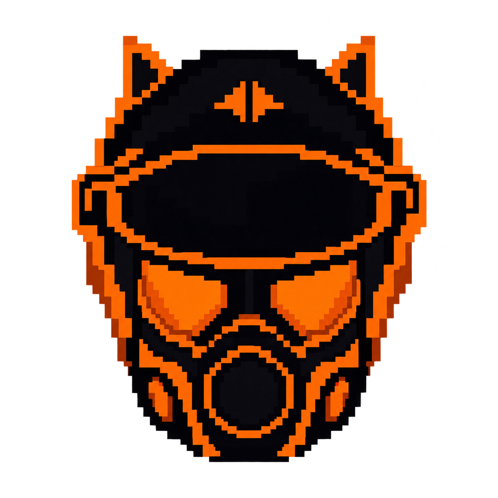

<p align="center">
  
</p>

<h1 align="center">HAVOC 9 TEAM ELIMINATION</h1>

<p align="center">
  <b>A fan-based, open-sourced community extension for <i>The Specialists 3.0</i></b><br>
  Objective-based, mapped, progressive siege and team elimination, themed in the Havoc Nine universe.
</p>

<p align="center">
  
  
  
  
  
</p>

<p align="center">
  <a href="#about">About</a> &middot;
  <a href="#game-modes">Game modes</a> &middot;
  <a href="#whats-in-it">What is in it</a> &middot;
  <a href="#building-from-this-repository">Building</a> &middot;
  <a href="#licensing-and-notices">Licensing</a> &middot;
  <a href="#credits">Credits</a>
</p>

---

## About

HAVOC 9 is a community extension that adds objective-based, mapped, progressive siege and team elimination mechanics to
**The Specialists 3.0**, themed in the Havoc Nine universe. It also carries useful DLL patching that gets past, and fixes,
bugs in TS 3.0 for AMX Mod X developers.

The extent of the major changes still works for GoldSrc, but some maps can reach engine limitations. The project employs the
fair use of **Xash3D**.

This work was made possible by our open source contributors, and by several developers using **SMAK**, the
*Studio Model Asset Kit* by [Deoroot](https://github.com/deoroot/SMAK), together with various agents. SMAK sits in this
repository as a git submodule of its own repository.

- Credit where credit is due: [creds_attribution.txt](creds_attribution.txt). We do not claim ownership of any assets.
- Read [SECURITY.md](SECURITY.md), use at your own risk, and visit the
  [Xash3D-FWGS repository](https://github.com/FWGS/xash3d-fwgs) for its notice on third-party builds.
- Missing assets in releases? Check [docs/GIT_LFS.txt](docs/GIT_LFS.txt).

## Game modes

The name of a map decides which game it plays; [docs/GAME_MODES.txt](docs/GAME_MODES.txt) has every setting, entity and command.

| Mode | Map name | How it plays |
|---|---|---|
| **Team Elimination** | `h9_te_` | The match mode. Two sides, the MSR and the Insurgents, fight elimination rounds: pick a class, every class has lives, the fallen return with their side's respawn wave, and the last minute is sudden death. |
| **Siege** | `h9_siege_` | Team elimination with objectives. The attackers plant charges on the objectives in order; every fall gives lives and time back, and the last one falling wins the round. |
| **Capture the Uplink** | `h9_up_` | Both sides fight over one carried objective, the uplink, and up to nine zones. Only the carrier takes a zone; holding every zone wins. |
| **Wave Survival** | `h9_ws_` | The survivors against a wave of bots that never runs out. Each wave comes all at once after a breather; the run ends when the survivors fall. |
| **Mech Warrior** | `h9_mw_` | The match with the classes cut down to the Officer, the Combat Engineer and as many Mechs as a side likes. Every bot plays a Mech. |
| **Assault** | `h9_as_` | Both sides fight over up to 24 capture points that anyone standing in them can take. A side's lives are one pool. |
| **Capture the Flag** | `h9_ctf_` | H9's own: each side has a flag on its pad. Take the enemy's, carry it to your own pad, and it scores. |
| **The game as it ships** | `dm_`, `tdm_`, `ts_`, `h9_dm_`, `h9_tdm_`, `h9_ctb_`, `ctb_`, `ctf_` | The Specialists' own deathmatch, team deathmatch and Capture the Briefcase, left as TS plays them. A map with any other name plays the game as it ships too. |
| **Roleplay** | `rp_`, `tsrp_` | Includes the Apollo RP scripts, played on the roleplay maps. It plays as normal Apollo RP or with H9's additions, by cvar. |

## What is in it

| | |
|---|---|
| **Roleplay** | Includes the Apollo RP scripts. H9's own additions (teams by job, property tax and a town treasury, shops, jobs and ranks) each have an `arp_h9_` cvar with a stock off, so the server can play normal Apollo RP or the H9 version. [docs/ARP_H9_ADDITIONS.txt](docs/ARP_H9_ADDITIONS.txt) |
| **Engine** | Xash3D FWGS with the H9 patch chain (`xash3d-h9-patches/`), including the optional AMD FSR 1 upscaler. [docs/H9_UPSCALE.txt](docs/H9_UPSCALE.txt) |
| **Mod code** | `reTS/`: the game and client libraries of the mod, rebuilt from the Half-Life SDK. |
| **Bots** | A patched RCBot that plays the objectives and the roleplay maps. |
| **Join without a forwarded port** | A relay and a small helper let a friend join your game with a code. [docs/P2P_RELAY.txt](docs/P2P_RELAY.txt) |
| **Web client** | The game in a browser, built from the same source: `build-webclient.cmd`. |
| **Tools** | Map, model and release tooling in `export-map/`, `modelling/` and `tools/`. |

## Building from this repository

**1. Git LFS.** The maps and models live in Git LFS. Install [Git LFS](https://git-lfs.com), then, in the clone:

```
git lfs install
git lfs pull
```

Without it the build scripts stop and name the files that are only pointers.

**2. SMAK.** SMAK is a git submodule. Clone with `git clone --recurse-submodules`, or in an existing clone:

```
git submodule update --init
```

**3. Every build and where it starts:** [docs/BUILDING.txt](docs/BUILDING.txt).

**The web client** builds from a fresh clone on Windows with one command:

```
build-webclient.cmd
```

It fetches Emscripten 6.0.12 (with its own Python, Node and Ninja) and CMake 4.3.0, about 820 MB, each file checked against a
pinned SHA-256. It then builds the engine and the reTS client for WebAssembly and lays out the game files in `webclient-build\`.
The first run takes about 10 minutes. Versions, checksums and steps: [docs/BUILDING.txt](docs/BUILDING.txt), section 9.

## Licensing and notices

> [!IMPORTANT]
> **The gamemode plugin code** (and the server, web and tool code around it) is licensed under the **GPLv3**; the license text
> sits in those folders (`LICENSE-GPLV3.txt`).
> **The mod code** (reTS: the game and client libraries) is under the **Half-Life SDK license** ([reTS/LICENSE](reTS/LICENSE)),
> and **not** under the GPLv3.
> The two are kept apart: [LICENSE.md](LICENSE.md) says which folder is under which license, and
> [THIRD_PARTY_LICENSES/](THIRD_PARTY_LICENSES/) holds the licenses of other people's work.

- This project inherits a lot of nested GPLv2, GPLv3 and MIT licensed tools and projects.
- **Xash3D-FWGS** is a nested repository and is considered unlicensed for all intents and purposes (see
  [H9XASH/UNLICENSED.MD](H9XASH/UNLICENSED.MD)).
- Using the Steam broker software, you agree to the Steam Web API Terms of Use, the Steamworks SDK Access Agreement and the
  Steam Subscriber Agreement.
- This is a fan-based passion project, made with the assistance of Claude.ai and community contributors.
- All copyrighted content belongs to its respective and trademarked owners. All Valve-related content and iconicity is the
  property of Valve Corporation.

> [!NOTE]
> **Non-commercial.** See [NON_COMMERCIAL.MD](NON_COMMERCIAL.MD). This is made explicitly for non-profit, but we cannot
> prevent others from doing otherwise.

> [!NOTE]
> **Game assets.** We replaced every proprietary Valve asset, in the full use of the Xash3D-FWGS engine. It is still a good idea
> to hold valid ownership of Half-Life and The Specialists 3.0, and we do not support piracy or pirated software.

## Credits

Everyone who made this possible is listed in [creds_attribution.txt](creds_attribution.txt).

<p align="center">
  <br>
  <sub>A fan-based passion project. Not affiliated with Valve Corporation.</sub>
</p>
