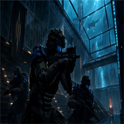
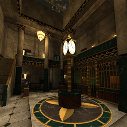
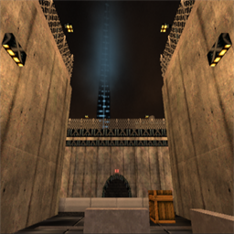
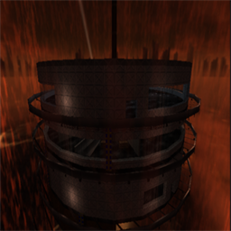
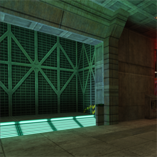
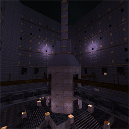
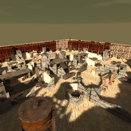
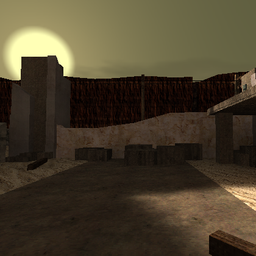

<p align="center">
  
</p>

<h1 align="center">HAVOC 9</h1>

<p align="center">
  <b>A fan-based, open-sourced community extension for <i>The Specialists 3.0</i></b><br>
  Objective-based, mapped, progressive siege and team elimination, themed in the Havoc Nine universe.
</p>

<p align="center">
  
  
  
  
  
</p>

<p align="center">
  <a href="#about">About</a> &middot;
  <a href="#game-modes">Modes</a> &middot;
  <a href="#whats-in-it">Features</a> &middot;
  <a href="#accounts-player-ids-and-career-xp">Accounts</a> &middot;
  <a href="#presets-and-map-configs">Presets</a> &middot;
  <a href="#steam-sign-in-and-networkingini">Steam</a> &middot;
  <a href="#running-the-master-server">Master server</a> &middot;
  <a href="#building-from-this-repository">Build</a> &middot;
  <a href="#licensing-and-notices">License</a> &middot;
  <a href="#credits">Credits</a>
</p>

---

## About

HAVOC 9 is a community extension that adds objective-based, mapped, progressive siege and team elimination mechanics to
**The Specialists 3.0**, themed in the Havoc Nine universe. It utilizes refined reTS source by [StevenlAFL](https://github.com/goldsrc-net/the-specialists), as well as custom scripting hooks, fixing important bugs in TS 3.0 for AMX Mod X developers.

It is heavily inspired by the visionary work of the original developer, **Cosmo**, who created the original Havoc 9 universe
that it is themed in.

**The website is here too.** The source of the havoc9.org website (`havoc9.org/`, with its backend in `h9web/`) is kept in this
repository, for parity with the game and for the archive. That way the site stays in step with the game, and it can outlive the
current attempt to revive The Specialists and carry new content of its own.

The extent of the major changes still works for GoldSrc, but some maps can reach engine limitations. The project employs the
fair use of **Xash3D**.

This work was made possible by our open source contributors, and by several developers using **SMAK**, the
*Studio Model Asset Kit* by [Deoroot](https://github.com/deoroot/SMAK), together with various agents. SMAK sits in this
repository as a git submodule of its own repository.

- Credit where credit is due: [creds_attribution.txt](creds_attribution.txt). We do not claim ownership of any assets.
- Read [SECURITY.md](SECURITY.md), use at your own risk, and visit the
  [Xash3D-FWGS repository](https://github.com/FWGS/xash3d-fwgs) for its notice on third-party builds.
- Missing assets in releases? Check [docs/GIT_LFS.txt](docs/GIT_LFS.txt).

> [!IMPORTANT]
> **Normal The Specialists 3.0 is completely playable in every way.**
>
> Everything H9 adds is optional and sits behind its own setting, so a server or a player can run the game exactly as it ships:
>
> - `h9_customweapons 0` gives TS 3.0's own weapons.
> - `h9_customhands 0` gives its own hands.
> - The H9 game modes run only on maps named for them (`h9_te_`, `h9_siege_` and so on). Any other map plays as TS plays it.
>
> Every setting is listed in [CVARS.md](CVARS.md).

## Game modes

The name of a map decides which game it plays; [docs/GAME_MODES.txt](docs/GAME_MODES.txt) has every setting, entity and command.

<table>
  <tr>
    <td align="center" width="25%"><br><b>Neuropolis</b><br><sub>Team Elimination, Siege, Assault, Uplink</sub></td>
    <td align="center" width="25%"><br><b>Meridian</b><br><sub>Team Elimination, Siege</sub></td>
    <td align="center" width="25%"><br><b>Drainage</b><br><sub>Assault, Capture the Flag, Mech Warrior, Uplink, Wave Survival</sub></td>
    <td align="center" width="25%"><br><b>The Lift</b><br><sub>Siege, Assault, Mech Warrior, Uplink, Wave Survival</sub></td>
  </tr>
  <tr>
    <td align="center" width="25%"><br><b>Hive City</b><br><sub>Roleplay: Alexandria, Paradise City and Xenon City combined</sub></td>
    <td align="center" width="25%"><br><b>New Byzantium</b><br><sub>Roleplay</sub></td>
    <td align="center" width="25%"><br><b>Wasteland</b><br><sub>Team Elimination, Uplink, Wave Survival, Mech Warrior, Assault, Capture the Flag</sub></td>
    <td align="center" width="25%"><br><b>Wasteland, the west court</b><br><sub>the ruins round a courtyard</sub></td>
  </tr>
</table>

| Mode | Map name | How it plays |
|---|---|---|
| **Team Elimination** | `h9_te_` | The match mode. Two sides, the MSR and the Insurgents, fight elimination rounds: pick a class, every class has lives, the fallen return with their side's respawn wave, and the last minute is sudden death. |
| **Siege** | `h9_siege_` | Team elimination with objectives. The attackers plant charges on the objectives in order; every fall gives lives and time back, and the last one falling wins the round. |
| **Capture the Uplink** | `h9_up_` | Both sides fight over one carried objective, the uplink, and up to nine zones. Only the carrier takes a zone; holding every zone wins. |
| **Wave Survival** | `h9_ws_` | The survivors against a wave of bots that never runs out. Each wave comes all at once after a breather; the run ends when the survivors fall. |
| **Mech Warrior** | `h9_mw_` | The match with the classes cut down to the Officer, the Combat Engineer and as many Mechs as a side likes. Every bot plays a Mech. |
| **Assault** | `h9_as_` | Both sides fight over up to 24 capture points that anyone standing in them can take. A side's lives are one pool. |
| **Capture the Flag** | `h9_ctf_` | H9's own: each side has a flag on its pad. Take the enemy's, carry it to your own pad, and it scores. |
| **The game as it ships** | `dm_`, `tdm_`, `ts_`, `h9_dm_`, `h9_tdm_`, `h9_ctb_`, `ctb_`, `ctf_` | The Specialists' own deathmatch, team deathmatch and Capture the Briefcase, left as TS plays them. A map with any other name plays the game as it ships too. |
| **Roleplay** | `rp_`, `tsrp_` | Includes the Apollo RP scripts, played on the roleplay maps. It plays as normal Apollo RP or with H9's additions, by cvar. |

## What is in it

| | |
|---|---|
| **Roleplay** | Includes the Apollo RP scripts. H9's own additions (teams by job, property tax and a town treasury, shops, jobs and ranks) each have an `arp_h9_` cvar with a stock off, so the server can play normal Apollo RP or the H9 version. [docs/ARP_H9_ADDITIONS.txt](docs/ARP_H9_ADDITIONS.txt) |
| **Engine** | Xash3D FWGS with the H9 patch chain (`xash3d-h9-patches/`), including the optional AMD FSR 1 upscaler. [docs/H9_UPSCALE.txt](docs/H9_UPSCALE.txt) |
| **Mod code** | `reTS/`: the game and client libraries of the mod, rebuilt from the Half-Life SDK. |
| **Bots** | A patched RCBot that plays the objectives and the roleplay maps. |
| **Join without a forwarded port** | A relay and a small helper let a friend join your game with a code. [docs/P2P_RELAY.txt](docs/P2P_RELAY.txt) |
| **Steam sign-in** | Optional, off by default, set in `networking.ini`. Support for the Steam broker by [Deoroot](https://github.com/Deoroot/Steam-Broker-Xash3D-MSR), which runs under AppID 480 (Spacewar). The broker program ships in `H9XASH/steam/`. [Details below](#steam-sign-in-and-networkingini) |
| **Master server** | The server list the Internet tab reads, with an optional Discord bot that manages it: `serverlist-bot/`. [How to run it](#running-the-master-server) |
| **Web client** | The game in a browser, built from the same source: `build-webclient.cmd`. |
| **Website** | The source of the havoc9.org site (`havoc9.org/`, with its backend in `h9web/`): pages for the server list, downloads, the browser client, the ladder, the forum and the credits. Kept here for parity with the game and for the archive, so that it can outlive the current attempt to revive The Specialists and carry new content of its own. |
| **Tools** | Map, model and release tooling in `export-map/`, `modelling/` and `tools/`. |

## Accounts, player IDs and career XP

**A havoc9.org account.** Make one on havoc9.org, then link the game to it: choose Link your Account in the main menu (or type
`.link` in chat on an H9 server) and approve the code the game shows on `havoc9.org/link`. The game then plays as your account,
with nothing to type or paste.

**No account needed.** Without one, H9XASH makes a random player ID for your install the first time it runs, and keeps using it.
It is not a hardware fingerprint and it is not a Steam ID. It is kept in `user_id.ini`, protected for your Windows user. A server
never sees the raw ID. It sees a different value on every server (your ID joined with that server's address). Delete `user_id.ini`,
or run `h9_regenerate_userid.bat`, and the next launch makes a new one. Keep `user_id.ini` and `device_id.ini` to yourself:
together they are your account in game. An AMX Mod X plugin reads the ID with `get_user_info(id, "h9_clientid", ...)`.
[docs/CUSTOM_XASH_USERID.txt](docs/CUSTOM_XASH_USERID.txt)

**Career XP.** Every havoc9.org account has a career level, Lv 0 to 99, earned as experience from kills and matches in every game
mode. It sits beside the Elo rating from ranked play, which stays the skill figure. The level shows as a badge by your name on the
in-game scoreboard, the forum and the ladder, and `.rank` in game shows your own rank or anyone's. Only proven players count: an
account whose game has proved it to that server, or a web client player. Bots and anyone else play as ever and earn nothing.
[docs/H9_COMPETITIVE.txt](docs/H9_COMPETITIVE.txt)

The level badge changes shape every ten levels, and Lv 0 is an account with no experience yet. Some of the 100:

| Lv 0 | Lv 10 | Lv 20 | Lv 30 | Lv 50 | Lv 70 | Lv 80 | Lv 99 |
|:-:|:-:|:-:|:-:|:-:|:-:|:-:|:-:|
|  |  |  |  |  |  |  |  |

**Seasons.** The ladder, the Elo rating, plays in numbered seasons, and career levels carry across all of them. A havoc9.org site
admin can end a season at any time: its final standings are archived and stay readable on the ladder, a new season begins with
everyone unrated (the next rated kill or match starts an account again from 1000), and every account keeps its career level and
experience. An admin can also reset the competitive seasons completely, back to Season 1, which drops every archived season and
again keeps the levels and experience. Both copy the site's database first and are written to the audit log.

## Presets and map configs

Two things set a server up: a preset before the game starts, and a map config after each map has loaded.

**Presets.** `H9XASH/presets/` holds alternate versions of the AMX Mod X files in `ts\addons\amxmodx\configs\`, and
`h9_presets.bat` (in `H9XASH/`) swaps them in. Run it and pick one of three things:

- **Swap one file.** Pick a target such as `ts_matchmode.cfg`, then the variant to put in its place.
- **Apply a profile.** Pick a tag, and every file that has a variant under that tag is swapped in at once. The shipped tags are
  the three game-mode presets, `TeamElimination`, `Siege` and `Assault`. Each has its own `plugins.<tag>.ini` (which plugins
  run) and a cfg for each mode plugin (`ts_matchmode`, `ts_assault`, `ts_ctf`, `ts_uplink`, `ts_survival`, `ts_mechwarrior`,
  `ts_rtv`).
- **Toggle one plugin** in `plugins.ini` on or off.

A preset file is named `<file>.<tag>.<ext>` after the file it replaces: `plugins.Siege.ini` replaces `plugins.ini`. Whatever is
about to be overwritten is backed up first, into `presets\backup\<timestamp>\`. Nothing in the presets folder is read by the
game or the server on its own; only `h9_presets.ps1` reads it. [H9XASH/presets/README.txt](H9XASH/presets/README.txt) has the
rules for adding your own. One file has a second job: `h9_preset.<tag>.cfg` becomes `configs\h9_preset.cfg`, which names the
preset in the server's reports to havoc9.org, where the server's plugins are judged against that mode's list of official files
([docs/H9_PRESENCE.txt](docs/H9_PRESENCE.txt)).

**Map configs.** Once a map has loaded and its plugins are up, the engine runs `ts\mapconfigs\<mapname>.cfg`, if the map has one.
It runs after the plugins' own configs, so it can override them for that map. A map's cfg holds for that map only: the next
map's configs set things back. The shipped maps use it for settings such as `tsm_respawns` and `tsm_roundtime`. The order is the
plugins' configs in `configs\` (with a preset in place, if you used one), then the map's cfg, which wins. This is a feature of the
H9XASH engine, and `h9_autoconfig 0` turns it off without removing the files.

## Steam sign-in and networking.ini

How the game finds servers is set in one file, `networking.ini`, next to `h9xash.bat`. Edit it with any text editor and start the
game with `h9xash.bat`. Nothing in it is a secret.

**Steam is optional, and off by default.** With `steam_broker=0` under `[client]` the game uses the server lists only and needs no
Steam at all. With `1` the launcher also starts the Steam broker by
[Deoroot](https://github.com/Deoroot/Steam-Broker-Xash3D-MSR). The broker gives the game Steam sign-in tickets and lets it browse
Steam's server list; the engine side is described in
[the broker protocol](xash3d-fwgs/Documentation/extensions/steam-broker.md). The broker program (`steam_broker.exe` and
`steam_api.dll`) ships in `H9XASH/steam/`, in the folder beside `h9xash.bat`. If either file is missing the launcher says so
and carries on without it.

**It uses AppID 480, Spacewar.** The broker starts Steam under the AppID set in `[broker]` (`steam_appid=480` and
`steam_browse_appid=480`). Spacewar is the sample app of the Steamworks SDK that Valve gives to developers, so this is a use of
Steam's own developer API. It is not a copy of anyone's game, and it is not pirated. It is also a grey area, and we say so: this
project is not Spacewar, and it asks Steam's services (sign-in tickets and the server browser) to do matchmaking under that ID,
which uses Steam's bandwidth. That is why it is entirely your choice. AppID 70 (Half-Life) is the other value that makes sense, for
joining a stock Steam server, and it needs an account that owns Half-Life. See also the Steam terms under
[Licensing and notices](#licensing-and-notices) and [docs/NETWORKING.txt](docs/NETWORKING.txt), section 6.

**The master server is set in the same file.**

| Setting | Section | What it does |
|---|---|---|
| `steam_broker` | `[client]` | `0` (default): no Steam. `1`: also start the Steam broker. |
| `steam_appid`, `steam_browse_appid` | `[broker]` | The AppID the broker starts Steam with, and browses under. `480` as it ships. Read only when `steam_broker=1`. |
| `list_bot` | `[client]` | The H9 master server that the Internet tab asks, `https://havoc9.org/serverlist` as it ships. For a list on your own PC, `http://127.0.0.1:8081`. |
| `list_static` | `[client]` | Other server lists, as comma-separated base URLs. The game fetches `<base>/v1/servers/ts` from each one. |
| `heartbeat` | `[server]` | `1` (default): a dedicated server started with `h9xash_server.bat` tells the master server every two minutes that it is up. `0` for a LAN or private server. |
| `heartbeat_url` | `[server]` | The master server that heartbeat goes to. |
| `port` | `[server]` | The UDP port a server takes, 27015 by default. Open it in the firewall and the router. |

With `list_bot` and `list_static` both empty the Internet tab has nothing to ask. The LAN tab and `connect` still work.

## Running the master server

The master server is the server list that the game's Internet tab reads, plus an optional Discord bot that manages it. It is
one Python process, in `serverlist-bot/` (GPLv3). The full guide is [serverlist-bot/README.md](serverlist-bot/README.md); what we
ask of the servers on the upstream master server is in [CODE_OF_CONDUCT.md](CODE_OF_CONDUCT.md). It is common-sense policy that
applies only there: modding and making things is welcome, and it is vitriol and blatant misuse that gets acted on. That includes
bots that fill every slot (they must leave one open), false servers, and adverts or websites pushed through simulated server
information.

We cannot govern what players do on a server. How a server is listed, demonstrated or advertised through the master server does
matter. Misusing it can lead to the suspension of your havoc9.org account and the blacklisting of IP addresses.

**Start it**

1. Run `serverlist-bot\install.bat`. It installs the Python packages and creates `serverlist.cfg`.
2. In `serverlist.cfg`, set `heartbeat_key` to a long random string. Set `discord_token` only if you want the Discord commands.
3. Check `serverlist.ini`. The port is 8081, not 8080: on Windows, Steam's own helper binds 8080, and the list would run but
   never receive a request.
4. Run `run.bat` and leave the window open. The list writes `serverlist.log` beside itself.
5. Open `http://127.0.0.1:8081/v1/servers/ts`. It shows a comment line, and no `ip` lines until a server gets on.

`serverlist.cfg` is a copy of [serverlist-bot/serverlist.cfg.example](serverlist-bot/serverlist.cfg.example) (`install.bat` makes it).
It holds the two secrets and nothing else, and it is git-ignored:

```ini
; serverlist.cfg -- the two secrets. Copy this file to serverlist.cfg and fill it in.
; serverlist.cfg is git-ignored and is never copied into the package.

[secrets]
; Servers send heartbeats with this key. Any long random string will do, and every server
; that sends heartbeats needs the same one. Empty means heartbeats are refused.
heartbeat_key =
; The Discord bot token, for the slash commands and the status. Empty means no Discord: the list runs alone.
; The H9_DISCORD_TOKEN environment variable or a systemd credential named discord_token is read first.
discord_token =
```

The `H9_DISCORD_TOKEN` environment variable, or a systemd credential named `discord_token`, works in place of the token line.

**Point the game at it.** The game reads `list_bot` in `networking.ini`, next to `h9xash.bat`. It ships as
`https://havoc9.org/serverlist`. For a test list on your own PC, use `http://127.0.0.1:8081` there and empty `public_url` in
`serverlist.ini`.

**Put a server on it.** A server is listed only while it answers a query and runs the `ts` game folder. It gets on in one of
three ways:

- `/addserver host:port` in Discord, by someone with the list role or Manage Server;
- a line in `servers.txt`, read when the list starts;
- a heartbeat, `POST /v1/heartbeat`. A dedicated server started with `h9xash_server.bat` sends one every two minutes. Any other
  server can send one on a timer, and a server that has the heartbeat key can name any address.

The list asks each server again every 30 seconds and takes it off after 5 minutes without an answer.

**Keep a server off it.** `blacklisted.ini` names the servers the list will not list. It is git-ignored, so
[serverlist-bot/blacklisted.ini.example](serverlist-bot/blacklisted.ini.example) is provided (`install.bat` copies it). One entry
to a line, with `;` or `#` for comments:

```ini
203.0.113.7           ; every server at that address, on any port
203.0.113.7:27016     ; that one server
203.0.113.0/24        ; every address in a range (IPv4)
fake.example.com      ; every server that host name stands for
```

The list re-reads the file whenever it changes, so an edit takes hold within 30 seconds with no restart. Every way onto the list is
held to it, including the heartbeat key, `servers.txt` and `/addserver`, and a server that is already listed is taken off. A
blacklisted heartbeat is answered 403.

**Discord.** Make an application in the Discord developer portal, add a bot, and invite it with the `bot` and
`applications.commands` scopes. Set `guild_id` in `serverlist.ini`, and `role_id` if only one role should change the list. The
commands are `/servers`, `/addserver` and `/removeserver`. The bot's status is green while a listed server answers, yellow when
the list is empty, and red when every listed server has gone quiet or the list cannot be reached.

**On a server.** The list listens on `127.0.0.1:8081`, nginx passes `/serverlist/` to it, and it runs as the `h9-serverlist`
service. [vps/linux/README-VPS.txt](vps/linux/README-VPS.txt) sets the whole machine up. A website can read the same list as JSON
from `/v1/servers/ts.json`.

## Building from this repository

**1. Git LFS.** The maps and models live in Git LFS. Install [Git LFS](https://git-lfs.com), then, in the clone:

```
git lfs install
git lfs pull
```

Without it the build scripts stop and name the files that are only pointers.

**2. SMAK.** SMAK is a git submodule. Clone with `git clone --recurse-submodules`, or in an existing clone:

```
git submodule update --init
```

**3. Every build and where it starts:** [docs/BUILDING.txt](docs/BUILDING.txt).

**The web client** builds from a fresh clone on Windows with one command:

```
build-webclient.cmd
```

It fetches Emscripten 6.0.12 (with its own Python, Node and Ninja) and CMake 4.3.0, about 820 MB, each file checked against a
pinned SHA-256. It then builds the engine and the reTS client for WebAssembly and lays out the game files in `webclient-build\`.
The first run takes about 10 minutes. Versions, checksums and steps: [docs/BUILDING.txt](docs/BUILDING.txt), section 9.

## Licensing and notices

> [!IMPORTANT]
> **The gamemode plugin code** (and the server, web and tool code around it) is licensed under the **GPLv3**; the license text
> sits in those folders (`LICENSE-GPLV3.txt`).
> **The mod code** (reTS: the game and client libraries) is under the **Half-Life SDK license** ([reTS/LICENSE](reTS/LICENSE)),
> and **not** under the GPLv3.
> The two are kept apart: [LICENSE.md](LICENSE.md) says which folder is under which license, and
> [THIRD_PARTY_LICENSES/](THIRD_PARTY_LICENSES/) holds the licenses of other people's work.

- This project inherits a lot of nested GPLv2, GPLv3 and MIT licensed tools and projects.
- **Xash3D-FWGS** is a nested repository and is considered unlicensed for all intents and purposes (see
  [H9XASH/UNLICENSED.MD](H9XASH/UNLICENSED.MD)).
- Using the Steam broker software, you agree to the Steam Web API Terms of Use, the Steamworks SDK Access Agreement and the
  Steam Subscriber Agreement.
- This is a fan-based passion project, made with the assistance of Claude.ai and community contributors.
- All copyrighted content belongs to its respective and trademarked owners. All Valve-related content and iconicity is the
  property of Valve Corporation.

> [!NOTE]
> **Non-commercial.** See [NON_COMMERCIAL.MD](NON_COMMERCIAL.MD). This is made explicitly for non-profit, but we cannot
> prevent others from doing otherwise.

> [!NOTE]
> **Game assets.** We replaced every proprietary Valve asset, in the full use of the Xash3D-FWGS engine. What each replacement is,
> and where it comes from, is in [H9XASH/valve/REPLACEMENTS.md](H9XASH/valve/REPLACEMENTS.md). It is still a good idea
> to hold valid ownership of Half-Life and The Specialists 3.0, and we do not support piracy or pirated software.

## Credits

Everyone who made this possible is listed in [creds_attribution.txt](creds_attribution.txt).

<p align="center">
  <br>
  <sub>A fan-based passion project. Not affiliated with Valve Corporation.</sub>
</p>
